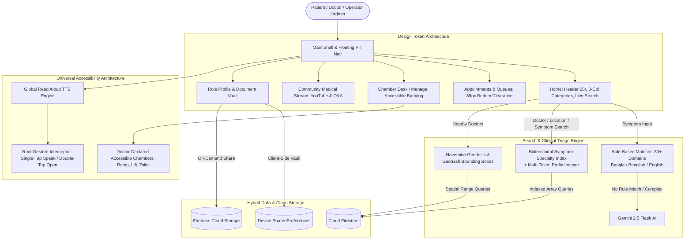
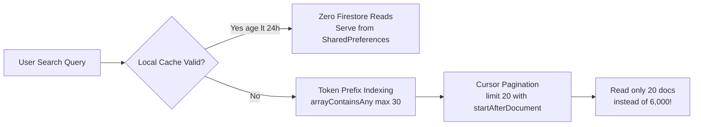
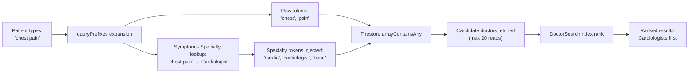
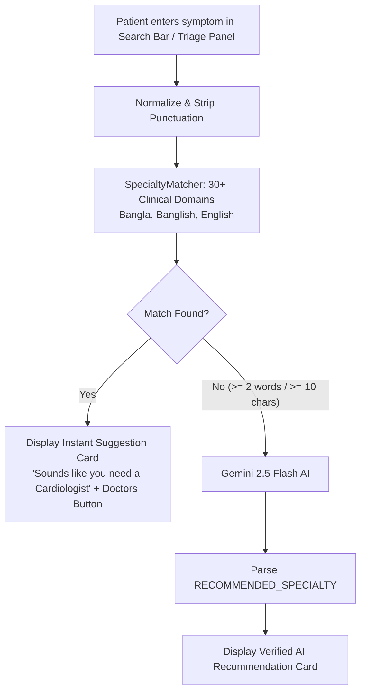
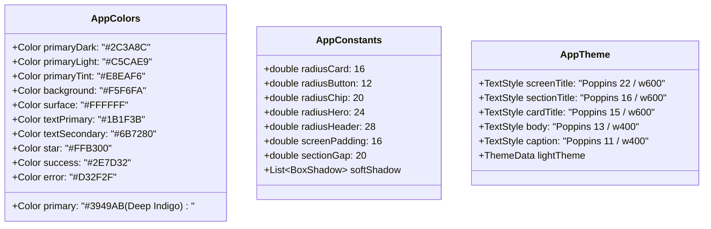

# DoctorDesk: Architecture, Algorithms & Faculty Defense Guide

> **Last updated:** October 2026 — reflects search index v2 (symptom→specialty bidirectional indexing), Gemini 2.5 Flash upgrade, bundled 6,000+ APK directory, and 6,000+ listed doctors count.

---

## 1. Executive Summary & System Architecture

**DoctorDesk** is a hybrid healthcare discovery, clinical triage, and real-time chamber queue management platform tailored for the Bangladesh healthcare ecosystem. The system is architected as an **offline-resilient Flutter client** backed by Google Cloud Firestore, Firebase Auth, Firebase Storage, and Google Gemini Generative AI, operating under a strict **design token system** and **universal accessibility architecture**.



---

## 2. Why We Hit the 50,000 Reads Limit & How We Tackled It

### The Root Cause: What Happened with 6,000 Doctors?

On Google Firebase's free **Spark plan**, Cloud Firestore grants **50,000 document reads per calendar day**.

1. **Unbounded Directory Scans:**
   If a collection contains 6,000 doctor documents, executing a naive query like:
   ```dart
   final snapshot = await FirebaseFirestore.instance.collection('doctors').get();
   ```
   consumes **6,000 document reads in a single invocation**. 
   Running this query just **8 to 9 times** (e.g., during emulator reloads, hot restarts, or multiple tests) results in:
   $$6{,}000 \times 9 = 54{,}000 \text{ reads} \implies \mathbf{100\% \text{ Quota Exceeded!}}$$

2. **Real-Time Stream Subscriptions:**
   Attaching `snapshots()` listeners to collections counts a read for *every existing document* when the listener connects, plus *additional reads for every modified document*.

3. **Uncached Remote Config Loads:**
   Loading dictionary rules or configuration documents on every app cold start without a cache validity check repeatedly burns read quotas.

---

### The 5 Engineering Solutions Implemented to Tackle the Limit



1. **Search Token Prefixing (`DoctorSearchIndex.queryPrefixes`):**
   Instead of downloading the entire database to filter locally, doctors have precomputed `searchPrefixes` (2–16 characters) stored as an indexed array in Firestore. Search queries use Firestore's `arrayContainsAny: prefixes` with a strict `limit(20)`. This retrieves **only 10–20 documents** instead of 6,000.
2. **Cursor-Based Pagination (`startAfterDocument`):**
   In [`firestore_service.dart`](file:///c:/Users/user/Downloads/docdesk/doctordesk-flutter/lib/services/firestore_service.dart), we replaced offset queries with document cursor snapshots. Each page loads exactly 20 records (`limit: 20`), ensuring predictable, minimal consumption.
3. **24-Hour Cache Time-To-Live (TTL):**
   In [`specialty_matcher.dart`](file:///c:/Users/user/Downloads/docdesk/doctordesk-flutter/lib/services/specialty_matcher.dart), remote rules are cached in device `SharedPreferences`. The app checks `cached_specialty_rules_fetched_at`; if the cache is under 24 hours old, Firestore is **never queried**.
4. **Geohash Spatial Bounding Ranges:**
   Rather than fetching all doctors and computing distances on the client, [`geofire_utils.dart`](file:///c:/Users/user/Downloads/docdesk/doctordesk-flutter/lib/services/geofire_utils.dart) generates lexicographical `[start, end]` string pairs based on geohashes. Firestore only queries chambers inside those specific bounding boxes.
5. **Pre-Bundled 6,000+ Listed Doctors in APK (`assets/data/bundled_doctors.json`):**
   All 6,048 merged doctor records (with multi-specialty and multi-chamber consolidation) are bundled directly inside the APK asset bundle and indexed in memory via `DoctorSearchIndex`, guaranteeing **0 Firestore reads** for directory browsing, specialty filtering (including ENT), symptom search, and Haversine nearby lookup.

---

## 3. Search Indexing Logic & Distance Algorithms

### A. The Haversine Geodesic Distance Formula

When a user searches for nearby doctors or chambers (e.g., Mirpur Cantonment, BUP Medical), distance is calculated on the Earth's spherical surface using the **Haversine formula** implemented in [`geofire_utils.dart`](file:///c:/Users/user/Downloads/docdesk/doctordesk-flutter/lib/services/geofire_utils.dart#L163-L174):

$$\Delta\phi = \phi_2 - \phi_1 = \text{radians}(\text{lat}_2 - \text{lat}_1)$$
$$\Delta\lambda = \lambda_2 - \lambda_1 = \text{radians}(\text{lon}_2 - \text{lon}_1)$$
$$a = \sin^2\left(\frac{\Delta\phi}{2}\right) + \cos(\phi_1) \cdot \cos(\phi_2) \cdot \sin^2\left(\frac{\Delta\lambda}{2}\right)$$
$$c = 2 \cdot \text{atan2}\left(\sqrt{a}, \sqrt{1 - a}\right)$$
$$d = R \cdot c$$

*where $R = 6371.0\text{ km}$ is Earth's mean radius.*

```dart
// Code location: lib/services/geofire_utils.dart
static double distanceBetweenKm(List<double> loc1, List<double> loc2) {
  const double radius = 6371.0;
  final latDelta = _degreesToRadians(loc2[0] - loc1[0]);
  final lonDelta = _degreesToRadians(loc2[1] - loc1[1]);
  final a = (math.sin(latDelta / 2.0) * math.sin(latDelta / 2.0)) +
      (math.cos(_degreesToRadians(loc1[0])) *
          math.cos(_degreesToRadians(loc2[0])) *
          math.sin(lonDelta / 2.0) *
          math.sin(lonDelta / 2.0));
  final c = 2.0 * math.atan2(math.sqrt(a), math.sqrt(1.0 - a));
  return radius * c;
}
```

### B. Geohash Spatial Bounding Boxes
Because Cloud Firestore does not have native geospatial indexing, DoctorDesk uses **Geohashes** (base-32 spatial encoding). Geohashes convert 2D coordinates $(lat, lng)$ into an interleaved binary string:
- Each character adds 5 bits of precision.
- Bounding box queries identify the minimum and maximum hash strings that completely encompass a circle of radius $r$, converting geospatial proximity into standard indexed string range queries:
  $$\text{geohash} \ge \text{bound}[\text{start}] \quad \text{AND} \quad \text{geohash} \le \text{bound}[\text{end}]$$

### C. Bidirectional Symptom-Specialty Search Index (v2)

[`doctor_search_index.dart`](file:///c:/Users/user/Downloads/docdesk/doctordesk-flutter/lib/services/doctor_search_index.dart) was upgraded to a **bidirectional symptom↔specialty index**, enabling patients to find doctors by describing their problem rather than knowing a specialty name.



**How indexing works at write time** (`fieldsFor()`):
Each doctor document stores three fields computed from their name, specialties, degrees, concentrations, and chamber locations:

| Field | Purpose | Example for a Cardiologist |
| :--- | :--- | :--- |
| `searchText` | Full normalized string for `contains()` scoring | `"dr jahangir kabir cardiology heart chest pain blood pressure palpitation cardiac ..."` |
| `searchTokens` | Individual tokens for equality queries | `["dr", "jahangir", "cardiology", "heart", "chest", "pain", ...]` |
| `searchPrefixes` | All 2–16 char prefixes for `arrayContainsAny` | `["ja", "jah", "jaha", ..., "cardio", "cardiolo", ...]` |

**Symptom keyword injection** — the core v2 feature:
When a doctor has specialty `"Cardiology"`, the indexer walks a chain:
1. Looks up `specialtyAbbreviations['cardiology']` → `['cardio', 'cardiologist', 'heart', ...]`
2. Resolves all canonical names (including multi-hop: `'cardio'` → `'cardiology'` → aliases)
3. For each canonical, looks up `_specialtyToSymptoms` (100+ symptom phrases mapped to specialties)
4. Injects those symptom phrases into `searchText`/`searchTokens`/`searchPrefixes`

Result: A patient searching `"chest pain"` finds cardiologists. `"hair loss"` finds dermatologists. `"সাইনাস"` finds ENT specialists. **No Firestore full scan needed.**

**Multi-specialty support:** A doctor with `["Medicine Specialist", "Cardiology"]` gets symptoms for **both** specialties injected. The `score()` function gives a `+400` bonus when a symptom phrase matches the doctor's specialty.

**The scoring matrix:**

| Match Category | Scoring Bonus | Example |
| :--- | :--- | :--- |
| **Exact Full Name** | $+1000$ points | Query: `"Nuzhat Saima"` $\rightarrow$ Doctor: Dr. Nuzhat Saima |
| **Name Starts With** | $+800$ points | Query: `"Nuzhat"` $\rightarrow$ Dr. Nuzhat Saima |
| **Core Name Word Match** | $+750$ points | Query: `"Saima"` $\rightarrow$ Dr. Nuzhat Saima |
| **Symptom→Specialty Match** | $+400$ points | Query: `"chest pain"` $\rightarrow$ Cardiologist |
| **Alias Expansion** | $+180$ points | `"md"` $\leftrightarrow$ `"mohammad"`, `"dr"` $\leftrightarrow$ `"doctor"` |
| **Medical Abbreviation** | $+120$ points | `"ent"` $\leftrightarrow$ `"otolaryngology"`, `"gynae"` $\leftrightarrow$ `"gynecology"` |
| **Text Substring Match** | $+40$ points | Query term present in degrees or chambers |
| **Missing Query Term** | **$-1$ (Disqualified)** | Any query term that cannot be satisfied rejects the candidate |

**Abbreviation synonyms supported** (bidirectional):
`ENT` ↔ `Otolaryngology`, `Gynae/OBGYN` ↔ `Gynecology`, `Ortho` ↔ `Orthopedics`, `Cardio` ↔ `Cardiology`, `Derm/Skin` ↔ `Dermatology`, `Peds/Paed` ↔ `Pediatrics`, `Eye/Ophth` ↔ `Ophthalmology`, `Neuro` ↔ `Neurology`, `Gastro` ↔ `Gastroenterology`, `Nephro/Kidney` ↔ `Nephrology`, `Pulmo/Chest` ↔ `Pulmonology`, `Endo/Diabetes` ↔ `Endocrinology`, `Med/GP` ↔ `General Medicine`, `Psych` ↔ `Psychiatry`, and more.

---

## 4. Rule-Based + AI Symptom Triage: Where & How

DoctorDesk implements a **two-tier triage architecture**:



### Where in the Code:
1. **Rule Engine:** [`lib/services/specialty_matcher.dart`](file:///c:/Users/user/Downloads/docdesk/doctordesk-flutter/lib/services/specialty_matcher.dart)
   - Contains clinical rules across 30+ specialties covering **English**, **Bangla script** (e.g., `বুকের ব্যথা`, `মাথা ঘোরা`), and **Banglish** (e.g., `buke chap`, `matha ghurache`, `bomi lage`).
   - Uses **longest-key sorting first** (`sortedKeys.sort((a,b) => b.length.compareTo(a.length))`) to ensure specific terms match before generic terms (e.g., `"chest pain"` matches Cardiology before `"pain"` matches Physical Medicine).
2. **Generative AI Fallback:** [`lib/services/gemini_service.dart`](file:///c:/Users/user/Downloads/docdesk/doctordesk-flutter/lib/services/gemini_service.dart)
   - Evaluates descriptive queries using **Gemini 2.5 Flash** (updated from deprecated 1.5/2.0 models) with strict medical triage system prompts.
   - Model fallback chain: `gemini-2.5-flash` → `gemini-2.5-flash-lite` → `gemini-2.0-flash-lite`.
3. **Auto-routing in Search Bar:** [`lib/screens/home_screen.dart`](file:///c:/Users/user/Downloads/docdesk/doctordesk-flutter/lib/screens/home_screen.dart)
   - Typing symptoms directly into the main search bar automatically triggers rule matching and AI triage inline, surfacing a clickable card right below the input field.

---

## 5. Universal Accessibility & Disability-Friendly Chambers

DoctorDesk incorporates comprehensive accessibility standards directly into its data models and interface:

### A. Disability-Friendly Chamber Architecture
- **Data Model:** Added `isAccessible` (`bool`, default `false`) and `accessibilityFeatures` (`List<String>`) to [`Chamber`](file:///c:/Users/user/Downloads/docdesk/doctordesk-flutter/lib/models/doctor.dart#L3-L24).
- **Chamber Management:** In [`DoctorManagerScreen`](file:///c:/Users/user/Downloads/docdesk/doctordesk-flutter/lib/screens/doctor_manager_screen.dart), doctors toggle *"Disability-friendly chamber"* and select declared features:
  - `Ramp` (Wheelchair ramp access)
  - `Lift/Elevator` (Vertical access to upper floors)
  - `Accessible washroom` (Wheelchair-accessible restroom)
  - `Ground floor` (Step-free ground floor entrance)
- **Ethical Labeling:** The UI explicitly displays the caption: *"This is declared by the doctor."* It is never falsely labeled as third-party certified.
- **Badge Propagation Logic:**
  - On the **Chamber Card** (Doctor Manager): Shows green icon + `"Accessible"` badge.
  - On the **Doctor Discovery Cards** (Home, Search, Top Doctors, Nearby): Shows the green accessibility badge **only if at least one active chamber** has `isAccessible == true`.
  - On the **Doctor Detail Screen**: Shows the `"Accessible"` badge with specific feature chips under chamber details.
  - On **Lists** (Specialties & Nearby): Adds an `"Accessible only"` filter chip.

### B. Global Read Aloud Text-to-Speech (TTS)
- **Centralized Service:** [`TtsService`](file:///c:/Users/user/Downloads/docdesk/doctordesk-flutter/lib/services/tts_service.dart) singleton backed by `flutter_tts` and persistent `SharedPreferences`.
- **Root Gesture Interception:** In [`lib/main.dart`](file:///c:/Users/user/Downloads/docdesk/doctordesk-flutter/lib/main.dart), `_ReadAloudGestureWrapper` inspects pointer events:
  - **Single Tap:** Speaks the tapped element's semantic label or paragraph text without blocking normal user interaction.
  - **Double Tap:** Executes the widget's underlying navigation or action (*"Tap any item to hear it. Double-tap to open"*).
- **Locale Synchronization:** TTS language dynamically switches between `en-US` and `bn-BD` matching the app language setting.
- **Role-Specific Placement:** The shared [`ReadAloudSettingTile`](file:///c:/Users/user/Downloads/docdesk/doctordesk-flutter/lib/widgets/read_aloud_setting_tile.dart) is placed inside an `"ACCESSIBILITY"` section placed directly above `"PREFERENCES"` in:
  - Patient: `"Settings"`
  - Doctor: `"Practice Settings"`
  - Operator: `"Chamber Desk Settings"`

---

## 6. Unified UI Design Token System

To eliminate hardcoded styling, DoctorDesk establishes centralized design tokens in [`lib/theme/app_constants.dart`](file:///c:/Users/user/Downloads/docdesk/doctordesk-flutter/lib/theme/app_constants.dart) and [`lib/theme/app_theme.dart`](file:///c:/Users/user/Downloads/docdesk/doctordesk-flutter/lib/theme/app_theme.dart):



### Key UI Features
- **Header:** Full-width `#3949AB` header with 28px bottom radius, circular 44px avatar, `"Welcome"`, user name, notification bell, and 48px rounded search bar with 14px radius.
- **3-Column Categories Grid:** 16px radius white tiles with 32px outlined primary icons and 12px labels.
- **Hero Card:** 24px radius container with gradient from `primaryTint` to `primaryLight`, equal-width outlined stat chips (no invented numbers), and distinct booking button.
- **Floating Pill Bottom Navigation:** Housed in `Scaffold.bottomNavigationBar`, margin 12 from edges and bottom, 24px radius, `primaryTint` background, soft drop shadow, labels always visible.
- **Scroll View Clearance:** Explicit bottom padding (80–96px) and `SafeArea` wrapping ensure bottom content (e.g., `"ABOUT DOCTORDESK"`, Log Out button) is never hidden behind the floating nav pill or Android system bar.
- **Google Vector Logo:** Clean 4-color Google vector paths implemented in [`GoogleLogoWidget`](file:///c:/Users/user/Downloads/docdesk/doctordesk-flutter/lib/widgets/google_sign_in_button.dart) using a lightweight custom canvas painter.

---

## 7. Division of Features Across 4 Team Members

| Member | Primary Focus Area | Key Files & Responsibilities | Core Technical Defense Points |
| :--- | :--- | :--- | :--- |
| **Member 1** | **Clinical Triage Engine, Multilingual AI & Global Read Aloud** | [`specialty_matcher.dart`](file:///c:/Users/user/Downloads/docdesk/doctordesk-flutter/lib/services/specialty_matcher.dart)<br>[`gemini_service.dart`](file:///c:/Users/user/Downloads/docdesk/doctordesk-flutter/lib/services/gemini_service.dart)<br>[`tts_service.dart`](file:///c:/Users/user/Downloads/docdesk/doctordesk-flutter/lib/services/tts_service.dart)<br>[`read_aloud_setting_tile.dart`](file:///c:/Users/user/Downloads/docdesk/doctordesk-flutter/lib/widgets/read_aloud_setting_tile.dart) | • Rule-based substring matching across 30+ domains.<br>• Banglish phonetic stem detection (`batha`, `jwor`, `buke chap`).<br>• Longest-match-first sorting to prevent false positives.<br>• Gemini 2.5 Flash generative AI fallback (updated from deprecated 1.5/2.0 models).<br>• Singleton TTS engine with dual locale sync (`en-US`, `bn-BD`) and root gesture hit-testing. |
| **Member 2** | **Search Indexing, Symptom→Specialty Engine & Geospatial Algorithms** | [`doctor_search_index.dart`](file:///c:/Users/user/Downloads/docdesk/doctordesk-flutter/lib/services/doctor_search_index.dart)<br>[`geofire_utils.dart`](file:///c:/Users/user/Downloads/docdesk/doctordesk-flutter/lib/services/geofire_utils.dart)<br>[`nearby_doctors_screen.dart`](file:///c:/Users/user/Downloads/docdesk/doctordesk-flutter/lib/screens/nearby_doctors_screen.dart)<br>[`doctors_screen.dart`](file:///c:/Users/user/Downloads/docdesk/doctordesk-flutter/lib/screens/doctors_screen.dart) | • Haversine formula calculation for geodesic distance ($R = 6371\text{ km}$).<br>• Geohash bounding box query generation.<br>• **Bidirectional symptom→specialty index** (v2): 100+ symptom phrases injected into searchPrefixes at index time.<br>• Multi-specialty doctors get symptoms for ALL their specialties indexed together.<br>• Multi-token search prefix arrays (`searchPrefixes`) capped at 30 (Firestore 2024 limit) mitigating 50k reads.<br>• Alias and medical abbreviation dictionary with multi-hop expansion chains.<br>• `"Accessible only"` filtering using `doctor.hasAccessibleChamber`. |
| **Member 3** | **Chamber Queue Operations & Disability-Friendly Chambers** | [`doctor_manager_screen.dart`](file:///c:/Users/user/Downloads/docdesk/doctordesk-flutter/lib/screens/doctor_manager_screen.dart)<br>[`operator_desk_screen.dart`](file:///c:/Users/user/Downloads/docdesk/doctordesk-flutter/lib/screens/operator_desk_screen.dart)<br>[`chamber_accessibility.dart`](file:///c:/Users/user/Downloads/docdesk/doctordesk-flutter/lib/widgets/chamber_accessibility.dart)<br>[`models/doctor.dart`](file:///c:/Users/user/Downloads/docdesk/doctordesk-flutter/lib/models/doctor.dart) | • Dual-role chamber management (doctor manages, operator runs desk).<br>• Chamber accessibility model (`isAccessible`, `accessibilityFeatures`).<br>• Add/Edit chamber dialog with disability feature chips.<br>• Reorderable live patient queues with ticket state updates.<br>• Firestore queue transactions (`waiting` $\rightarrow$ `in_progress` $\rightarrow$ `done`). |
| **Member 4** | **Patient Portal, Document Vault & Design Token System** | [`theme/app_theme.dart`](file:///c:/Users/user/Downloads/docdesk/doctordesk-flutter/lib/theme/app_theme.dart)<br>[`theme/app_constants.dart`](file:///c:/Users/user/Downloads/docdesk/doctordesk-flutter/lib/theme/app_constants.dart)<br>[`document_service.dart`](file:///c:/Users/user/Downloads/docdesk/doctordesk-flutter/lib/services/document_service.dart)<br>[`health_documents_widget.dart`](file:///c:/Users/user/Downloads/docdesk/doctordesk-flutter/lib/widgets/health_documents_widget.dart)<br>[`profile_screen.dart`](file:///c:/Users/user/Downloads/docdesk/doctordesk-flutter/lib/screens/profile_screen.dart) | • Centralized Design Token system (Deep Indigo palette, Poppins, radii).<br>• Floating pill bottom navigation bar with safe clearance.<br>• Client-side local document storage with on-demand cloud share.<br>• Patient privacy protection (zero reads/writes until user shares).<br>• BMDC & NID verification security gate for doctors. |

---

## 8. Testing Credentials & Seeded Cloud Profiles

The database script [`scripts/seed_demo_accounts_and_reviews.js`](file:///c:/Users/user/Downloads/docdesk/doctordesk-flutter/scripts/seed_demo_accounts_and_reviews.js) provisions live accounts and dynamic reviews:

### A. Dummy Patient Accounts (with dynamic Firestore reviews)
| Email | Password | Role | Description |
| :--- | :--- | :--- | :--- |
| `rafiq@mail.com` | `rafiq123` | Patient | Tested review: 5★ consultation at BUP Medical |
| `fatema@mail.com` | `fatema123` | Patient | Tested review: 5★ friendly consultation for viral fever |
| `tariq@mail.com` | `tariq123` | Patient | Tested review: 4★ punctual chamber checkup |
| `sabina@mail.com` | `sabina123` | Patient | Tested review: 5★ recommendation for Mirpur area |

### B. Doctor Account & BUP Medical Profile
- **Email:** `nuzhatsaima.16@gmail.com` (Password: `nuzhat123`)
- **Doctor Name:** Dr. Nuzhat Saima
- **Designation & Degrees:** Consultant Physician, MBBS
- **Specialty:** General Medicine
- **Chamber:** **BUP Medical** (Bangladesh University of Professionals Main Campus, Mirpur Cantonment, Section 12, Dhaka-1216)
- **Coordinates:** $23.8398^\circ\text{ N}, 90.3582^\circ\text{ E}$
- **BMDC Verification Badge:** Explicitly set to `false` (pending official BMDC registration certificate)
- **Reviews:** 4 dynamic patient reviews stored in Cloud Firestore (not hardcoded) with a 4.9★ rating average.

### C. Desk Operator Account
- **User UID:** `uHlqUgF07vZ8Ie4z54KinN9i0Li1`
- **Assigned Chambers:**
  1. `chamber-bup-1`: BUP Medical Center Chamber (Mirpur Cantonment)
  2. `demo-chamber`: Popular Diagnostic Desk 01 (Central)

---

## 9. Faculty Defense Q&A Cheatsheet

### Q1: Why did you implement disability accessibility as "Doctor-declared" rather than "Verified"?
> **Answer:** In Bangladesh healthcare, there is currently no centralized accreditation board that inspects private chamber wheelchair accessibility. If we claimed chambers were "Verified Accessible", a patient in a wheelchair might arrive at a clinic and find broken elevators or unmanageable stairs, creating legal liability and physical harm. Labeling it *"Doctor-declared accessible chamber"* provides transparency, and itemized feature chips (*Ramp*, *Lift/Elevator*, *Accessible washroom*) give patients specific details about what accommodations exist.

### Q2: Why use Haversine on the client rather than spatial queries in Firestore?
> **Answer:** Cloud Firestore is a document store without native GIS functions like PostGIS or MongoDB `$nearSphere`. Firestore queries can only filter on 1-dimensional ranges. We use **Geohashes** to query bounding boxes on Firestore, which limits document reads to a tight geographical area. Once those candidate documents are retrieved, the client computes the exact spherical geodesic distance using the Haversine formula ($R = 6371.0\text{ km}$), providing sub-meter precision with zero extra database costs.

### Q3: Why doesn't the Floating Bottom Navigation Bar overlap scrollable content?
> **Answer:** Standard bottom navigation bars consume scaffold space automatically. Floating navigation bars with custom margins float *above* the body canvas. To guarantee full visibility, every scrollable screen ([`HomeScreen`](file:///c:/Users/user/Downloads/docdesk/doctordesk-flutter/lib/screens/home_screen.dart), [`FeedScreen`](file:///c:/Users/user/Downloads/docdesk/doctordesk-flutter/lib/screens/feed_screen.dart), [`AppointmentScreen`](file:///c:/Users/user/Downloads/docdesk/doctordesk-flutter/lib/screens/appointment_screen.dart), [`ProfileScreen`](file:///c:/Users/user/Downloads/docdesk/doctordesk-flutter/lib/screens/profile_screen.dart), [`SettingsScreen`](file:///c:/Users/user/Downloads/docdesk/doctordesk-flutter/lib/screens/settings_screen.dart)) uses explicit bottom padding (80–96px) and wraps scroll contents inside `SafeArea`. This ensures the lowest items scroll comfortably above the navigation pill and the device gesture navigation bar.

### Q4: How does Read Aloud work across arbitrary Flutter widgets without breaking gestures?
> **Answer:** Rather than manually wrapping hundreds of widgets in tap listeners, we implemented `_ReadAloudGestureWrapper` at the `MaterialApp` root builder. It intercepts pointer down events via `Listener(behavior: HitTestBehavior.translucent)`. When `TtsService.isReadAloudEnabled` is true, a single tap runs `hitTestInView` to extract paragraph text or semantic labels and speaks them through `flutter_tts`. A double tap (detected within a 350ms window and 40px radius) passes through to trigger the widget's default interactive action.

### Q5: How does searching "chest pain" or "hair loss" find the right doctor without a full database scan?
> **Answer:** We implemented a **bidirectional symptom→specialty index** (v2). At indexing time, when a doctor is stored in Firestore, we look up all symptom phrases that map to their specialty (e.g., Cardiology → chest pain, palpitation, blood pressure, heart attack, etc.) and inject those phrases directly into the doctor's `searchPrefixes` array. When a patient types "chest pain", `queryPrefixes()` detects the symptom phrase, maps it to "Cardiologist", and adds those specialty tokens alongside the raw "chest" and "pain" tokens for Firestore's `arrayContainsAny` query. Multi-specialty doctors (e.g., Medicine Specialist + Cardiologist) get **both** symptom sets indexed. The entire operation reads at most 20–60 documents from Firestore — never a full collection scan.

### Q6: Why does "medicine dr" search correctly find medicine specialist doctors?
> **Answer:** The `DoctorSearchIndex` uses a multi-hop abbreviation expansion chain. The token `"med"` maps to `["general medicine", "medicine", "gp", ...]`. `"gp"` maps to `["general physician", ...]`. `"general physician"` maps to `["medicine", ...]`. Any of these tokens appearing in the query causes `queryPrefixes()` to emit the full chain, and the stored `searchPrefixes` for a Medicine Specialist doctor includes all these tokens from indexing time. The result is robust cross-vocabulary matching despite no standardized specialty naming in Bangladesh.

### Q7: What happens when the user is offline?
> **Answer:** DoctorDesk has a 3-layer offline resilience strategy: (1) On the first successful load, all doctor records, speciality lists, and total counts are cached in `SharedPreferences`. (2) On subsequent offline loads, the app reads from cache with zero Firestore reads and shows an amber "Offline mode" banner. (3) Specialty triage rules (loaded from Firestore `config/specialty_rules`) are cached for 24 hours before being refreshed. The app never shows a blank screen due to network failure — it degrades gracefully to cached data.
