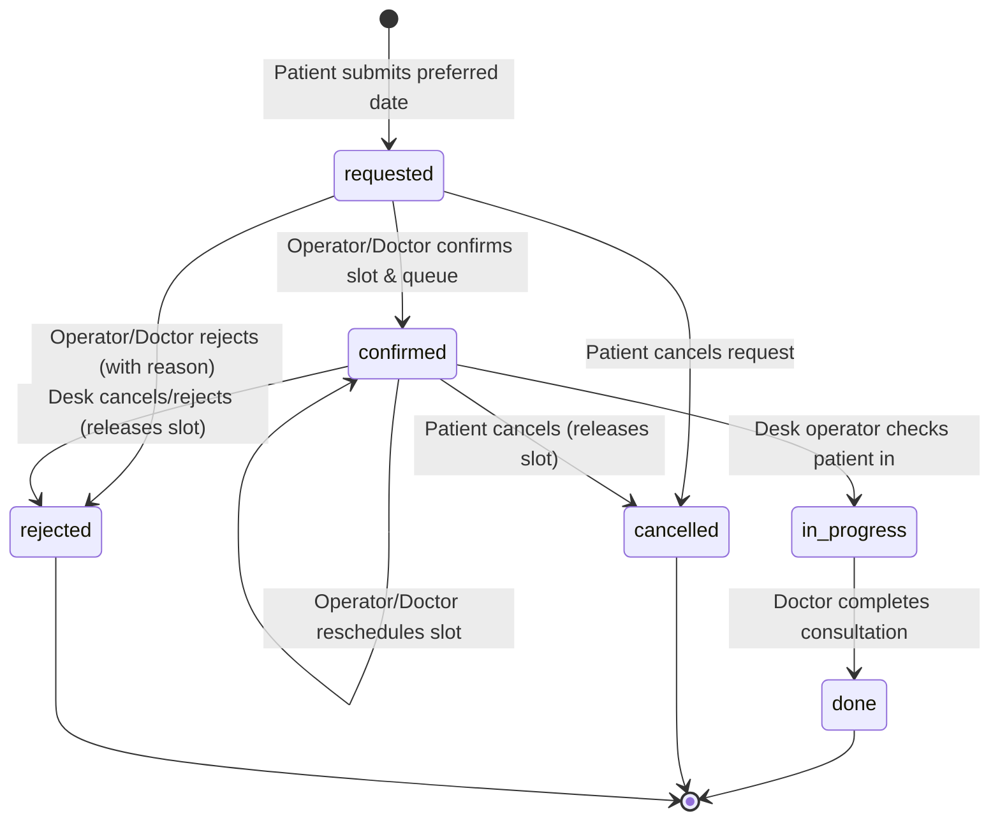
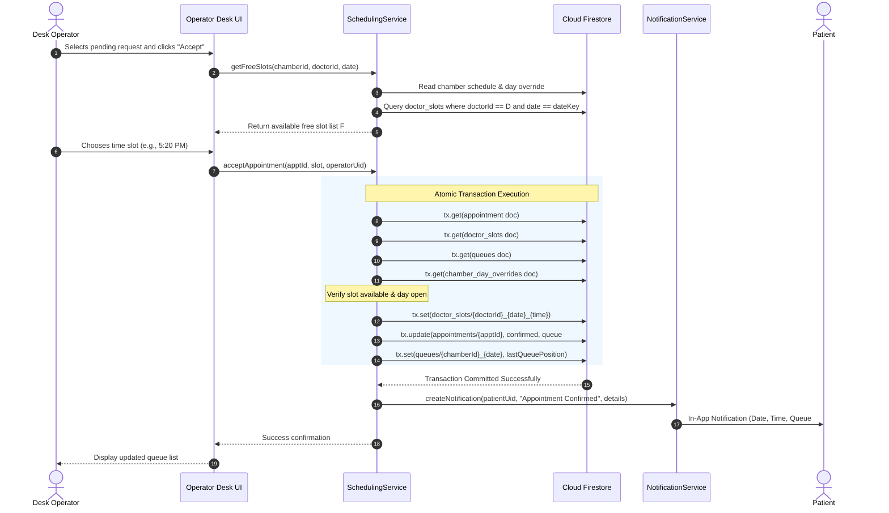

# DocDesk Appointment Scheduling Algorithm Specification

## 1. Introduction and Problem Context

Outpatient clinical care in Bangladesh operates predominantly through multi-chamber specialist consultations. A specialist medical practitioner typically consults at multiple physical chambers (e.g., diagnostic centers, private hospitals, and clinics) across distinct time blocks within a week.

Traditional clinical queues in this environment rely either on purely unreserved First-Come, First-Served (FCFS) walk-in queuing or on rigid, static time-slot booking systems. Both paradigms exhibit critical failure modes in practice:
- **FCFS Walk-in Queuing**: Patients endure volatile waiting times averaging 2 to 4 hours in crowded waiting rooms. No upper bound on patient intake is guaranteed, leading to clinical overcrowding and sudden walk-in rejections late in the evening.
- **Static Fixed-Slot Scheduling**: Doctors frequently face traffic delays, emergency hospital rounds, or surgical overruns. If a doctor arrives 45 minutes late, a static slot system collapses: all subsequent slots are instantly misaligned, creating cascading confusion, missed appointments, and frustrated patients.

DocDesk addresses this reality through a **Dynamic Constrained-Window Timed-Slot Reservation Model with Atomic Distributed Locks**. This architecture combines:
1. Deterministic timed slot reservations with sequential chamber queue positions.
2. Dynamic operator- or doctor-adjustable day overrides (allowing dynamic shifts in consultation start/end windows without silent cancellation).
3. Cross-chamber global doctor conflict avoidance through $O(1)$ deterministic document locks in Cloud Firestore.
4. Guaranteed atomic state transitions ensuring zero double-booking even under concurrent booking submissions across disparate chambers.

---

## 2. Requirements Specification

### 2.1 Functional Requirements (FR)

- **FR1 (Preferred Date Request)**: A patient can submit an appointment request specifying a doctor, chamber, and preferred date. At the request stage, no specific time slot or sequential queue number is assigned.
- **FR2 (Exclusive Triage Authority)**: The designated chamber desk operator (or the doctor directly if no operator is assigned to the chamber) possesses exclusive authority to `Accept`, `Reschedule`, or `Reject` (with a mandatory clinical/administrative reason) pending requests.
- **FR3 (Constrained Free-Slot Generation)**: The system dynamically computes the discrete set of valid free consultation slots for a target date using the chamber's weekly schedule, effective slot length, and any active daily overrides. Only system-enumerated free slots may be selected during acceptance or rescheduling.
- **FR4 (Cross-Chamber Global Invariant)**: A doctor cannot be scheduled for two concurrent active/confirmed consultations at any time, across any combination of chambers.
- **FR5 (Deterministic Sequential Queue Allocation)**: Upon appointment confirmation, the system assigns a monotonically increasing, non-reusable queue number specific to the chamber and consultation date.
- **FR6 (Dynamic Daily Overrides)**: A doctor or authorized chamber operator can dynamically adjust a consultation date's start and end times, declare the day `closed`, mark it `full`, or `reopen` it.
- **FR7 (Automatic Saturation)**: Daily capacity is strictly derived from the consultation window duration and slot length. When confirmed appointments reach capacity ($N$), the date is marked as saturated (`full`), preventing subsequent reservations.
- **FR8 (Bi-directional Patient Notification)**: Patients receive automated in-app notifications for every state transition, explicitly indicating old and new consultation times on rescheduling and reasons on rejection.
- **FR9 (Slot Deallocation on Cancellation)**: When a patient cancels or an operator/doctor rejects an appointment, the associated time slot is immediately released and made available for reservation.

### 2.2 Non-Functional Requirements (NFR)

- **NFR1 (Consistency & Atomicity)**: Slot reservation and queue assignment must execute in a single atomic database transaction ($ACID$). Concurrent confirmation attempts on the same doctor time slot must guarantee that exactly one transaction succeeds while conflicting transactions abort cleanly.
- **NFR2 (Security & Principle of Least Privilege)**: Patients are strictly forbidden from modifying time slots, queue counters, daily overrides, or transitioning appointments to confirmed statuses. Security rules in `firestore.rules` enforce these constraints independently of UI controls.
- **NFR3 (Algorithmic Performance)**: 
  - Slot collision validation and reservation operate in $O(1)$ time via deterministic document IDs (`doctor_slots/{doctorId}_{yyyyMMdd}_{HHmm}`).
  - Free slot generation operates in $O(S)$ time, where $S \le 96$ is the total slots in a daily window ($S \le 16\text{ hours} \times 6\text{ slots/hr}$). No unbounded collection scans are performed.
- **NFR4 (Availability & Fault Resilience)**: Read operations leverage local Firestore persistence caching. Mutation operations require active connectivity; write failures produce clear, actionable error messages.
- **NFR5 (Ergonomics & Usability)**: All appointment times are formatted in standard 12-hour format (`hh:mm a`). Touch targets conform to a minimum dimension of $48\text{ dp}$, and text elements maintain a minimum contrast ratio of $4.5:1$ against backgrounds.
- **NFR6 (Patient Privacy Preservation)**: Patients are restricted from reading other patients' names, records, or appointment specifics. Publicly accessible schedule endpoints expose only aggregate capacity indicators (e.g., "$k$ slots left").
- **NFR7 (Auditability & Traceability)**: Every state mutation records `updatedBy` (UID of the initiating actor) and `updatedAt` (server timestamp). BM&DC verification updates remain append-only.
- **NFR8 (Temporal Determinism)**: All calendar date computations, slot partitions, and cutoffs are evaluated in the official Bangladesh Standard Time zone (`Asia/Dhaka`, $\text{UTC}+6$). Timestamps are persisted as native UTC `Timestamp` primitives.
- **NFR9 (Maintainability & Test Coverage)**: Centralized query builders and scheduling services encapsulate all domain logic, fully verified via automated Cloud Firestore emulator suites.

---

## 3. Mathematical Formulation and Algorithm

### 3.1 Definitions

Let:
- $c \in \mathcal{C}$ denote a specific chamber.
- $d \in \{0, 1, \dots, 6\}$ denote the day of the week, where $0 = \text{Sunday}, \dots, 6 = \text{Saturday}$.
- $W(c, d) = [T_{\text{start}}, T_{\text{end}}]$ represent the baseline weekly consultation window for chamber $c$ on day $d$.
- $L_c \in [5, 15] \subset \mathbb{Z}^+$ denote the consultation slot duration in minutes (default $L_c = 10$).
- $O(c, \text{date})$ denote an optional administrative override for chamber $c$ on a calendar date:
  $$O(c, \text{date}) = \langle T'_{\text{start}}, T'_{\text{end}}, L'_c, \text{status} \rangle$$
  where $\text{status} \in \{\text{open}, \text{closed}, \text{full}\}$.
- The **effective consultation window** $E(c, \text{date})$ is defined as:
  $$E(c, \text{date}) = \begin{cases} \emptyset & \text{if } O(c, \text{date}).\text{status} \in \{\text{closed}, \text{full}\} \\ [T'_{\text{start}}, T'_{\text{end}}] & \text{if } O(c, \text{date}) \text{ exists with status } \text{open} \\ W(c, d) & \text{otherwise} \end{cases}$$

### 3.2 Capacity and Slot Generation

Given effective window $E(c, \text{date}) = [T_s, T_e]$ and effective slot length $L$:
1. **Capacity** $N$:
   $$N = \left\lfloor \frac{T_e - T_s}{L} \right\rfloor$$
   *Example*: For $T_s = \text{17:00}$ (5:00 PM), $T_e = \text{21:00}$ (9:00 PM), and $L = 10\text{ minutes}$:
   $$N = \left\lfloor \frac{240\text{ min}}{10\text{ min}} \right\rfloor = 24\text{ slots}$$

2. **Total Slot Set** $S(c, \text{date})$:
   $$S(c, \text{date}) = \{ T_s + i \cdot L \mid 0 \le i < N \}$$

3. **Free Slot Set** $F(c, \text{doctorId}, \text{date})$:
   Let $U(\text{doctorId}, \text{date})$ be the set of slots currently reserved across all chambers for doctor $\text{doctorId}$ on $\text{date}$, retrieved from collection `doctor_slots`.
   Let $P(\text{now})$ denote the set of slots in the past if $\text{date} = \text{today}_{\text{Dhaka}}$.
   $$F(c, \text{doctorId}, \text{date}) = \begin{cases} \emptyset & \text{if } E(c, \text{date}) = \emptyset \\ S(c, \text{date}) \setminus U(\text{doctorId}, \text{date}) \setminus P(\text{now}) & \text{otherwise} \end{cases}$$

---

### 3.3 Atomic Reservation Algorithm

```
Algorithm 1: Atomic Appointment Confirmation and Slot Reservation
Input: appointmentId, selectedSlot, actorUid
Output: Success or Error

1:  dateKey ← FormatDate(selectedSlot, "yyyyMMdd", Asia/Dhaka)
2:  timeKey ← FormatTime(selectedSlot, "HHmm", Asia/Dhaka)
3:  slotDocId ← doctorId + "_" + dateKey + "_" + timeKey
4:
5:  execute in Firestore.runTransaction(tx):
6:      apptSnap ← tx.get(appointments.doc(appointmentId))
7:      if not apptSnap.exists then
8:          abort("Appointment document does not exist.")
9:      end if
10:     doctorId ← apptSnap.data.doctorId
11:     chamberId ← apptSnap.data.chamberId
12:
13:     // Read all required resources before performing mutations
14:     slotRef ← doctor_slots.doc(slotDocId)
15:     slotSnap ← tx.get(slotRef)
16:     queueRef ← queues.doc(chamberId + "_" + dateKey)
17:     queueSnap ← tx.get(queueRef)
18:     overrideRef ← chamber_day_overrides.doc(chamberId + "_" + dateKey)
19:     overrideSnap ← tx.get(overrideRef)
20:
21:     // Invariant checks
22:     if overrideSnap.exists and overrideSnap.data.status in ["closed", "full"] then
23:         abort("Target date is closed or fully booked.")
24:     end if
25:     if slotSnap.exists and slotSnap.data.appointmentId ≠ appointmentId then
26:         abort("Slot collision: selected slot is already reserved.")
27:     end if
28:
29:     // Queue calculation
30:     lastPos ← queueSnap.exists ? queueSnap.data.lastQueuePosition : 0
31:     nextQueue ← (apptSnap.data.queuePosition ≠ null) ? apptSnap.data.queuePosition : (lastPos + 1)
32:
33:     // Release old slot lock if rescheduling
34:     oldSlotId ← apptSnap.data.slotId
35:     if oldSlotId ≠ null and oldSlotId ≠ slotDocId then
36:         tx.delete(doctor_slots.doc(oldSlotId))
37:     end if
38:
39:     // Atomic writes
40:     tx.set(slotRef, {
41:         doctorId: doctorId,
42:         chamberId: chamberId,
43:         appointmentId: appointmentId,
44:         date: dateKey,
45:         startTime: Timestamp(selectedSlot)
46:     })
47:     tx.update(appointments.doc(appointmentId), {
48:         status: "confirmed",
49:         scheduledTime: Timestamp(selectedSlot),
50:         queuePosition: nextQueue,
51:         slotId: slotDocId,
52:         updatedBy: actorUid,
53:         updatedAt: serverTimestamp()
54:     })
55:     if apptSnap.data.queuePosition = null then
56:         tx.set(queueRef, {
57:             chamberId: chamberId,
58:             date: dateKey,
59:             lastQueuePosition: nextQueue,
60:             updatedAt: serverTimestamp()
61:         }, merge: true)
62:     end if
```

---

### 3.4 System Invariants

- **Invariant $I_1$ (Strict Doctor Slot Exclusivity)**:
  $$\forall s_1, s_2 \in \text{doctor\_slots}, \quad s_1.\text{id} = s_2.\text{id} \implies s_1.\text{appointmentId} = s_2.\text{appointmentId}$$
  A doctor cannot have more than one confirmed consultation in any discrete time slot regardless of chamber location.
- **Invariant $I_2$ (Capacity Bound)**:
  $$\sum_{\text{appt} \in \text{Confirmed}(c, \text{date})} 1 \le N(c, \text{date})$$
  The total number of confirmed appointments cannot exceed derived capacity.
- **Invariant $I_3$ (Monotonic Queue Numbering)**:
  For any chamber $c$ on date $d$, queue numbers are monotonically increasing positive integers:
  $$Q_{k+1} = Q_k + 1, \quad Q_1 = 1$$
  Once assigned to a patient, queue numbers are never reassigned or reused on the same date.
- **Invariant $I_4$ (Single Active Booking per Patient-Doctor-Date)**:
  $$\text{count}(\text{active\_bookings}, \langle \text{patient}, \text{doctor}, \text{chamber}, \text{date} \rangle) \le 1$$
  Duplicate pending or confirmed requests from the same patient to the same doctor on the same date are rejected.

---

### 3.5 Comparative Analysis: FCFS vs. Fixed Slots vs. Dynamic Window Slots

| Dimension | Pure FCFS Walk-in | Static Fixed-Slot | DocDesk Dynamic Window Slots |
| :--- | :--- | :--- | :--- |
| **Arrival Predictability** | Zero: all patients arrive at opening | High on paper, brittle in practice | High: patient assigned a specific slot & queue |
| **Doctor Arrival Delay Tolerance** | High: queue simply starts late | Low: entire schedule collapses | **High**: doctor/operator shifts window; system notifies |
| **Waiting Room Crowding** | Severe (20–40 patients at once) | Low until delay occurs | **Minimal**: paced arrivals per $L$-minute intervals |
| **Cross-Chamber Protection** | None (manual coordinator calling) | Vulnerable to cross-database conflicts | **Atomic $O(1)$ lock** via `doctor_slots` |
| **Queue Position Retention** | Lost if patient steps away | None (time slot only) | **Persistent**: both queue number and slot time retained |

---

## 4. State Transition & Process Workflows

### 4.1 Appointment Lifecycle State Machine



### 4.2 Sequence Diagram: Atomic Appointment Acceptance


